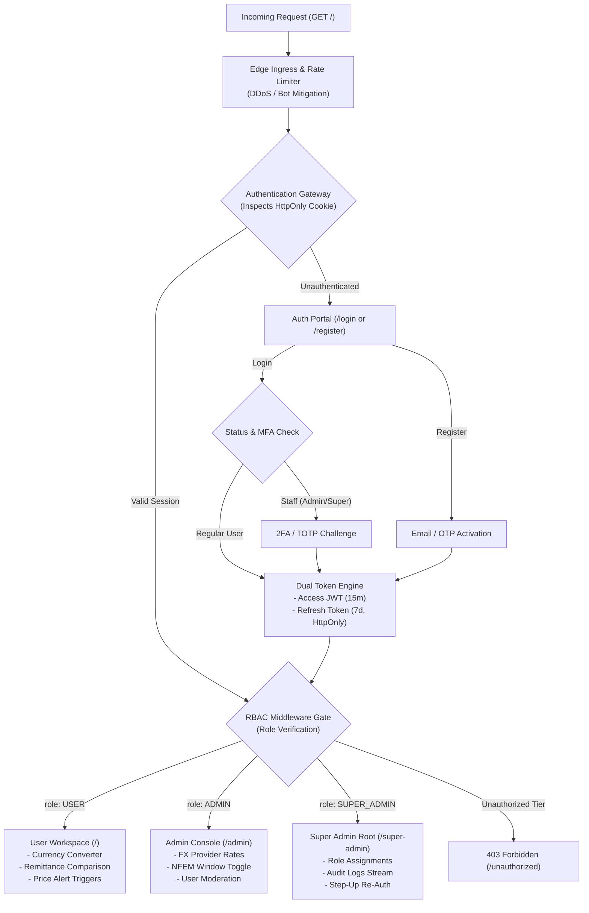

# 📈 RateConvert FX Rails

> **Institutional Foreign Exchange Intelligence, Multi-Provider Remittance Arbitrage & Developer API Rails**  
> *Engineered for Nigerian & Emerging Market FX Complexities (NFEM 2.0, Parallel BDC Cash, and Bank Card Spreads).*

[](https://nextjs.org/)
[](https://www.typescriptlang.org/)
[](https://tailwindcss.com/)
[](https://www.prisma.io/)
[](https://mikemcl.github.io/decimal.js/)
[](https://rate-convert001.vercel.app)

---

## 🌐 Live Production Deployment

* **Production URL:** [https://rate-convert001.vercel.app](https://rate-convert001.vercel.app)
* **GitHub Repository:** [https://github.com/muazumikail1915-create/rate-convert](https://github.com/muazumikail1915-create/rate-convert)

---

## 🎯 Executive Summary & Core Problem Solved

In emerging and multi-tier currency markets (notably Nigeria's Naira), traditional converters like Google Finance or XE display a single theoretical mid-market benchmark (e.g. ₦1,540/USD) that cannot be executed in the real world.

**RateConvert resolves this by providing operational rate transparency:**
1. **Three Concurrent FX Market Tiers:**
   * **Official Central Bank (NFEM):** Interbank autonomous clearing rates aligned with FMDQ OTC price discovery.
   * **Commercial Bank Card Rates:** What local banks (GTBank, Access, Zenith) debit for international cards and wires.
   * **Parallel / Bureau De Change (BDC):** Street cash and P2P exchange benchmarks.
2. **Net Take-Home Remittance Arbitrage:** Calculates the exact net payout across top remittance corridors (**Wise, LemFi, Flutterwave, Sendwave**) after fixed and percentage fee deductions, highlighting the true **Best Value** provider.
3. **NFEM Window Tracking:** Monitors the active trading window (**09:00 - 16:30 WAT**, Mon–Fri) so businesses avoid wide closing spreads and illiquid weekend markups.
4. **Automated Price Threshold Alerts:** Background evaluation engine that notifies users via email the second an exchange rate crosses their target price.
5. **Developer API Rails:** RESTful endpoints protected by API keys and plan-based rate limiting to power external fintech apps and accounting software.

---

## 🏛️ System Architecture

The platform is designed around an **Auth Gateway First (Gated Zero-Trust)** security model, backed by an **Edge Middleware**, **Dual-Token Engine**, and **Real-Time FX Synchronization**:



---

## 🔑 Pre-Configured Sandbox Accounts

For review, grading, and testing, the platform includes pre-seeded roles with 1-click login shortcuts directly on the `/login` screen:

| Tier | Email | Password | 2FA Code | Workspace Destination |
| :--- | :--- | :--- | :--- | :--- |
| **Regular User** | `user@rateconvert.com` | `User123!` | *None* | `/` (Main Market Dashboard) |
| **Desk Admin** | `admin@rateconvert.com` | `Admin123!` | `123456` | `/admin` (Desk Administration) |
| **Super Admin** | `superadmin@rateconvert.com` | `SuperAdmin123!` | `123456` | `/super-admin` (Root Security) |

---

## 🛠️ Tech Stack & Key Libraries

| Layer | Technologies |
| :--- | :--- |
| **Framework** | **Next.js 14** (App Router, Server Components, Route Handlers, Edge Middleware) |
| **Language** | **TypeScript 5.6** (Strict type safety, end-to-end typed API contracts) |
| **Styling & UI** | **Tailwind CSS**, Lucide Icons, Custom Responsive Data Visualizations |
| **Math Precision** | **Decimal.js** (28-digit floating-point precision avoiding currency round-off bugs) |
| **Charts** | **Recharts** (Interactive historical timeseries: 24H, 7D, 30D, 90D, 1Y) |
| **Security & Auth**| **jose** (Edge-compatible JWTs), **bcryptjs** (Salted password hashing) |
| **Database & ORM** | **Prisma ORM** (Models for User, RefreshToken, VerificationToken, AuditLog) |
| **Live FX Data** | **Global Open FX Feed API** with cross-rate calculation and resilient fallback |

---

## 📁 Repository Directory Structure

```text
rate-convert/
├── app/                              # Next.js App Router
│   ├── (auth)/
│   │   ├── login/page.tsx            # Auth Gateway Login + 2FA Challenge + 1-Click Sandbox
│   │   ├── register/page.tsx         # Account Registration & Password Complexity Validator
│   │   ├── verify/page.tsx           # 6-Digit Email OTP Verification Screen
│   │   └── unauthorized/page.tsx     # 403 Access Denied RBAC Handler
│   ├── admin/page.tsx                # Admin Console (Provider control, moderation, sync)
│   ├── super-admin/page.tsx          # Super Admin Console (RBAC role assignment, audit logs)
│   ├── api/
│   │   ├── auth/                     # Authentication & Session Handlers
│   │   │   ├── login/route.ts        # Credential verification, lockout check, MFA challenge
│   │   │   ├── register/route.ts     # User provisioning, OTP generation
│   │   │   ├── verify-email/route.ts # Activates user upon valid OTP
│   │   │   ├── mfa/verify/route.ts   # Resolves 2FA and grants elevated tokens
│   │   │   ├── refresh/route.ts      # HttpOnly refresh token rotation
│   │   │   ├── logout/route.ts       # Revokes refresh token, wipes cookies
│   │   │   └── me/route.ts           # Returns current authenticated user claims
│   │   ├── admin/                    # Privileged Administration Routes
│   │   │   ├── users/route.ts        # User moderation & role reassignment
│   │   │   └── audit-logs/route.ts   # Immutable security audit log stream
│   │   └── v1/                       # Public Developer RESTful API Rails
│   │       ├── currencies/route.ts   # Supported world and African currency metadata
│   │       ├── rates/latest/route.ts # Live spot prices for any currency pair
│   │       ├── rates/convert/route.ts# Decimal.js high-precision conversion
│   │       ├── rates/compare/route.ts# Ranked remittance arbitrage matrix
│   │       ├── rates/historical/route.ts # Historical chart timeseries
│   │       ├── market/status/route.ts# NFEM session status & turnover volume
│   │       ├── market/sync/route.ts  # On-demand live FX network synchronization
│   │       ├── alerts/route.ts       # User price threshold alert registration
│   │       └── keys/route.ts         # Developer API key generation & validation
│   ├── layout.tsx                    # Root layout with fonts & metadata
│   └── page.tsx                      # Authenticated Market Dashboard & Converter Home
├── components/                       # Modular UI Components
│   ├── Navbar.tsx                    # Header with live WAT clock, user badge & console links
│   ├── FXTicker.tsx                  # Live market ticker with pulse indicator & sync trigger
│   ├── Converter.tsx                 # Real-time exchange rate calculator
│   ├── RateComparison.tsx            # Multi-provider remittance table with net payouts
│   ├── RateChart.tsx                 # Historical SVG price chart (Recharts)
│   ├── MarketIntelligence.tsx        # NFEM window liquidity & parallel market spread card
│   ├── DeveloperPortalModal.tsx      # Modal with API key generation & cURL snippets
│   ├── AlertModal.tsx                # Rate alert registration modal
│   └── Flags.tsx                     # Vector country flag renderer
├── lib/
│   ├── server/                       # Backend Infrastructure
│   │   ├── auth.ts                   # Password hashing, JWT signing, cookie utilities
│   │   ├── jwt-edge.ts               # Edge-runtime compatible token verifier
│   │   ├── db.ts                     # In-memory & Prisma-synced database repository
│   │   ├── live-fx-service.ts        # External FX feed consumer, cross-rates & alert engine
│   │   ├── rate-limiter.ts           # Sliding-window API rate limiter
│   │   ├── rate-service.ts           # Core business logic for calculations & comparisons
│   │   └── types.ts                  # Shared TypeScript interfaces & models
│   ├── calculator.ts                 # Decimal.js currency formatting & conversion logic
│   └── mock-rates.ts                 # Baseline currency pairs, providers, and historical seeds
├── prisma/
│   └── schema.prisma                 # Schema definitions (User, Session, Token, AuditLog, FX)
├── scripts/                          # Automated Verification & Integration Test Suites
│   ├── test-auth-gateway.mjs         # 16-test suite verifying Auth, MFA, RBAC, Cookies, Logout
│   ├── test-live-fx.mjs              # 10-test suite verifying live feeds, spreads, alerts
│   ├── test-api.mjs                  # Regression suite for all REST API endpoints
│   └── test-rate-limits.mjs          # Rate limiter stress test
├── middleware.ts                     # Next.js Root Security & Auth Gateway Middleware
├── package.json                      # Dependencies and npm scripts
└── tsconfig.json                     # TypeScript configuration
```

---

## ⚡ Getting Started (Local Development)

### 1. Prerequisites
* **Node.js** v18.17+ or v20+
* **npm** v9+ or **pnpm** / **yarn**

### 2. Installation
Clone the repository and install dependencies:

```bash
git clone https://github.com/muazumikail1915-create/rate-convert.git
cd rate-convert
npm install
```

### 3. Environment Variables
Create a `.env` file in the project root:

```env
DATABASE_URL="file:./dev.db"
JWT_SECRET="your-32-character-crypto-secret-key-here"
NODE_ENV="development"
PORT=3000
```

### 4. Running the Development Server
```bash
npm run dev
```

Open [http://localhost:3000](http://localhost:3000) in your browser.  
*(Because the Auth Gateway is active, unauthenticated visits automatically route to `/login`)*.

---

## 🧪 Automated Testing & Quality Gates

The codebase includes targeted automated test suites verifying security, live market sync, and API regression:

```bash
# 1. Type Check
npx tsc --noEmit

# 2. Linting Check
npm run lint

# 3. Production Build Validation
npm run build

# 4. Auth Gateway & RBAC Security Suite (16 Tests)
node scripts/test-auth-gateway.mjs

# 5. Live FX Feed & Real-Time Alert Evaluation Suite (10 Tests)
node scripts/test-live-fx.mjs

# 6. RESTful API Regression Suite (8 Endpoints)
node scripts/test-api.mjs
```

---

## 📡 RESTful Developer API Reference

All endpoints return standardized JSON payloads:

### 1. Latest Spot Rates
```http
GET /api/v1/rates/latest?base=USD&target=NGN
```
```json
{
  "success": true,
  "data": {
    "pair": "USD/NGN",
    "rates": [
      { "sourceName": "CBN Official (NFEM)", "sourceType": "official", "buyRate": 1348.45 },
      { "sourceName": "Wise (TransferWise)", "sourceType": "provider", "buyRate": 1399.69 },
      { "sourceName": "Parallel Market (BDC)", "sourceType": "parallel", "buyRate": 1418.57 }
    ],
    "timestamp": "2026-11-05T12:00:00.000Z"
  }
}
```

### 2. High-Precision Currency Conversion
```http
POST /api/v1/rates/convert
Content-Type: application/json

{
  "amount": "2500",
  "from": "USD",
  "to": "NGN",
  "type": "provider"
}
```

### 3. Ranked Remittance Comparison (Net Take-Home)
```http
GET /api/v1/rates/compare?amount=1000&from=USD&to=NGN
```

### 4. Trigger Live FX Feed Sync
```http
POST /api/v1/market/sync
```

---

## 🚀 Production Deployment (Vercel)

1. Push your changes to your GitHub repository:
   ```bash
   git push origin main
   ```
2. In your [Vercel Dashboard](https://vercel.com):
   * Import the repository.
   * Under **Project Settings $\rightarrow$ Environment Variables**, configure:
     * `JWT_SECRET`: Random 32+ character string.
     * `NODE_ENV`: `production`
3. Click **Deploy**. Vercel will build the Edge middleware, serverless functions, and optimized static pages automatically with global CDN delivery.

---

## 📄 License & Attribution

Distributed under the **MIT License**. Built with high-precision engineering standards for financial data transparency.
